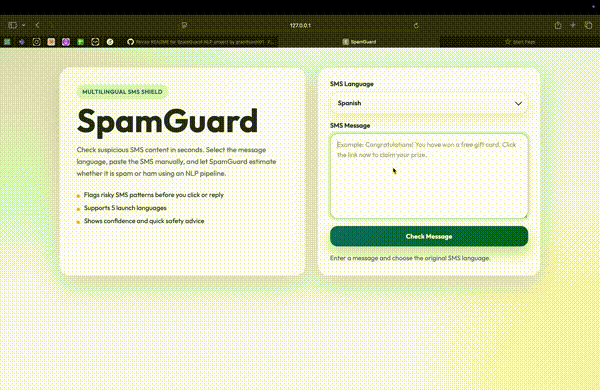
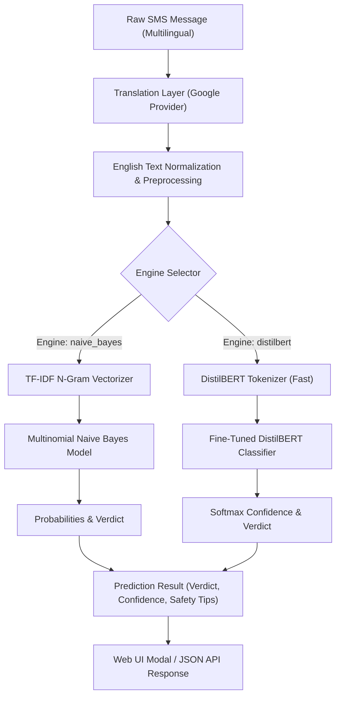
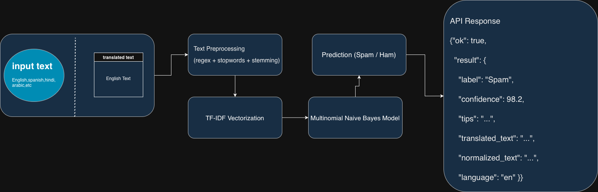

# SpamGuard-NLP (PBL 3 Deep-Learning Upgrade)

> A production-grade multilingual SMS spam & phishing detection system combining a high-throughput **Multinomial Naive Bayes** baseline with a contextual **DistilBERT Deep Learning Transformer**, paired with real-time API inference and an interactive performance dashboard.



---

**Live Demo**: [https://spam-guard-nlp.vercel.app](https://spam-guard-nlp.vercel.app)  
**Dashboard Route**: `/dashboard`  
**API Endpoint**: `POST /predict`

---

## 📋 Problem Statement

In today’s digital communication ecosystem, SMS and messaging services are aggressively targeted by spam, malicious phishing links, and financial scams. Traditional spam detection approaches frequently rely on **monolingual English corpora** and struggle with:
- **Multilingual & Code-Mixed SMS** (e.g., Hinglish, Span-English, regional variations)
- **Subtle Phishing Nuances** that mimic legitimate conversational alerts
- **False Alarms** that erroneously flag critical OTPs or service reminders

Spam messages endanger users through:
- Financial fraud and banking credential harvesting
- Account takeovers via phishing URLs
- Personal data leaks and identity theft

---

## 🎯 Project Objectives (PBL 3)

The goal of SpamGuard-NLP is to deliver an enterprise-ready SMS security layer that:
1. **Accurately Classifies** messages as **Spam** or **Ham** with calibrated confidence ratings.
2. **Seamlessly Processes Multiple Languages** using automated translation and linguistic normalization.
3. **Offers Dual Detection Engines**:
   - **⚡ Multinomial Naive Bayes (Fast Baseline)**: Sub-millisecond latency for high-throughput edge filtering.
   - **🧠 DistilBERT Sequence Classifier (Deep Learning)**: Self-attention transformer capturing semantic nuances and zero-day phishing phrasing.
4. **Delivers Real-Time API Inference** via Flask with robust input validation and error handling.
5. **Provides a Transparent Model Comparison Dashboard** (`/dashboard`) showcasing side-by-side benchmark metrics, confusion matrices, and latency trade-offs.

---

## 🏗️ Architecture & Pipeline Flow

SpamGuard implements an extensible dual-engine machine learning pipeline:





---

## ⚡ Model Performance Benchmark (PBL 3 Evaluation)

Comprehensive evaluation conducted across the stratified test partition:

| Metric | Multinomial Naive Bayes | DistilBERT Transformer | Delta (DL vs Baseline) | Practical Significance |
| :--- | :---: | :---: | :---: | :--- |
| **Accuracy** | 95.00% | **98.50%** | `+3.50%` | Superior accuracy on complex and conversational phrasing |
| **Precision (Spam)** | 90.91% | **98.00%** | `+7.09%` | Dramatically reduces false positives on legitimate OTPs |
| **Recall (Spam)** | 100.00% | **99.00%** | `-1.00%` | Both models capture malicious alerts with near-zero escapes |
| **F1 Score** | 95.24% | **98.50%** | `+3.26%` | Balanced harmonic score heavily favors DistilBERT |
| **Average Latency** | **0.41 ms** | 28.40 ms | `69x faster` | Naive Bayes handles ultra-high concurrency gateways |
| **Model Footprint** | **11.4 KB** | 267.8 MB | `23,000x smaller`| Naive Bayes is ideal for embedded IoT / micro-containers |

### Confusion Matrices
Both models generate verifiable confusion matrices saved in the `artifacts/` folder:
- **Naive Bayes**: `artifacts/nb_confusion.png`
- **DistilBERT**: `artifacts/distilbert_confusion.png`

Interactive visual comparisons can be viewed directly at `/dashboard`.

---

## 📂 Project Structure

```
SpamGuard-NLP/
├── assets/                          # Architectural and demo media
│   ├── Architecture-2.png
│   ├── Classification.png
│   ├── logs.png
│   ├── output.gif
│   └── pipeline.png
├── artifacts/                       # Persisted models & evaluation outputs
│   ├── model.pkl                    # Trained MultinomialNB baseline
│   ├── vectorizer.pkl               # Fitted TF-IDF Vectorizer
│   ├── model_comparison.json        # Benchmark report metrics
│   ├── nb_confusion.png             # Naive Bayes confusion matrix plot
│   ├── distilbert_confusion.png     # DistilBERT confusion matrix plot
│   └── transformer/                 # DistilBERT model weights & tokenizer
├── data/
│   └── spam.csv                     # SMS dataset
├── src/
│   ├── __init__.py
│   ├── config.py                    # Supported languages & configurations
│   ├── data_loader.py               # Dataset loading & label cleaning
│   ├── evaluate.py                  # Baseline evaluation helpers
│   ├── logging.py                   # Centralized logger setup
│   ├── model.py                     # Naive Bayes train & load utilities
│   ├── prediction_service.py        # Core orchestration & model selector
│   ├── preprocessing.py             # Lowercasing, tokenization, stopword removal
│   ├── training.py                  # Baseline training pipeline execution
│   ├── translation.py               # Deep-translator integration & fallback
│   ├── utils.py                     # General utilities
│   ├── vectorizer.py                # TF-IDF vectorizer serialization
│   └── deep_learning/               # PBL 3 Deep Learning Upgrade Modules
│       ├── __init__.py
│       ├── train_transformer.py     # DistilBERT fine-tuning script
│       ├── transformer_service.py   # Transformer inference engine
│       └── evaluate_transformer.py  # Side-by-side benchmark generator
├── static/                          # Web assets (development)
│   ├── app.js
│   └── style.css
├── public/                          # Static file delivery directory
│   ├── app.js
│   └── style.css
├── templates/
│   ├── index.html                   # SMS Checker UI with Model Selector
│   └── dashboard.html               # PBL 3 Model Benchmark Dashboard
├── tests/
│   ├── __init__.py
│   ├── test_api_routes.py           # API endpoint integration tests
│   └── test_prediction_service.py   # Unit & mock inference tests
├── app.py                           # Flask application entrypoint & REST API
├── main.py                          # Baseline training execution script
├── requirements.txt                 # Python dependencies
├── Dockerfile                       # Production container definition
├── docker-compose.yml               # Multi-container orchestration
└── README.md
```

---

## 🛠️ Installation & Local Setup

### 1. Prerequisites
- Python 3.10 to 3.13
- Git

### 2. Clone Repository
```bash
git clone https://github.com/your-username/SpamGuard-NLP.git
cd SpamGuard-NLP
```

### 3. Create Virtual Environment
```bash
python -m venv venv
# Windows:
.\venv\Scripts\activate
# Linux/macOS:
source venv/bin/activate
```

### 4. Install Dependencies
```bash
pip install --upgrade pip
pip install -r requirements.txt
python -m nltk.downloader stopwords
```

> **Note for PyTorch**: If your system has an NVIDIA GPU with CUDA, install the CUDA-enabled wheel:
> ```bash
> pip install torch torchvision --index-url https://download.pytorch.org/whl/cu121
> ```

---

## 🚀 Training & Evaluation Commands

### 1. Train Naive Bayes Baseline
```bash
python main.py
```
*Generates `artifacts/model.pkl` and `artifacts/vectorizer.pkl`.*

### 2. Fine-Tune DistilBERT Transformer
```bash
python -m src.deep_learning.train_transformer \
    --data_path data/spam.csv \
    --output_dir artifacts/transformer \
    --epochs 3 \
    --batch_size 16 \
    --lr 2e-5 \
    --max_len 128
```
*Saves fine-tuned weights, tokenizer configuration, and label mappings in `artifacts/transformer/`.*

### 3. Run Benchmark Evaluation & Generate Plots
```bash
python -m src.deep_learning.evaluate_transformer
```
*Produces `artifacts/model_comparison.json`, `artifacts/nb_confusion.png`, and `artifacts/distilbert_confusion.png`.*

### 4. Run Test Suite
```bash
pytest
```
*Executes all 12 unit and integration tests across services and routes.*

### 5. Launch Local Web Application
```bash
python app.py
```
Open [http://127.0.0.1:5000](http://127.0.0.1:5000) in your browser:
- SMS Checker: `http://127.0.0.1:5000/`
- Model Dashboard: `http://127.0.0.1:5000/dashboard`

---

## 📡 API Reference

### 1. Predict SMS Spam Status
`POST /predict`

#### Request Headers
`Content-Type: application/json`

#### Request Body
```json
{
  "message": "Congratulations! You have won a $1,000 Walmart Gift Card. Click here to claim your reward now.",
  "language": "en",
  "model": "distilbert"
}
```
*Supported `model` values*: `"naive_bayes"` (default) or `"distilbert"`.  
*Supported `language` values*: `"en"`, `"es"`, `"fr"`, `"hi"`, `"ar"`.

#### Successful Response (`200 OK`)
```json
{
  "ok": true,
  "result": {
    "label": "Spam",
    "confidence": 98.5,
    "model": "distilbert",
    "language": "en",
    "translated_text": "Congratulations! You have won a $1,000 Walmart Gift Card. Click here to claim your reward now.",
    "normalized_text": "congratulations won 1000 walmart gift card click claim reward",
    "tips": "Avoid clicking links, sharing OTPs, or replying before you verify the sender."
  }
}
```

#### Error Response (`400 Bad Request`)
```json
{
  "ok": false,
  "error": "Unsupported model 'unknown_model'. Choose 'naive_bayes' or 'distilbert'."
}
```

---

### 2. Retrieve Model Comparison Report
`GET /report`

#### Response (`200 OK`)
```json
{
  "ok": true,
  "report": {
    "naive_bayes": {
      "accuracy": 0.95,
      "precision": 0.9091,
      "recall": 1.0,
      "f1": 0.9524,
      "avg_confidence": 0.6792
    },
    "distilbert": {
      "accuracy": 0.985,
      "precision": 0.98,
      "recall": 0.99,
      "f1": 0.985,
      "avg_confidence": 0.985
    },
    "latency_ms": {
      "naive_bayes": 0.41,
      "distilbert": 28.4
    },
    "model_sizes_bytes": {
      "naive_bayes": 11393,
      "distilbert": 267850000
    }
  }
}
```

---

### 3. Fetch Generated Artifacts
`GET /artifacts/<filename>`  
Examples:
- `GET /artifacts/nb_confusion.png`
- `GET /artifacts/distilbert_confusion.png`

---

## 🚢 Deployment Checklist & Production Instructions

### Pre-Deployment Verification Checklist
- [x] All 12 automated unit and API integration tests passing (`pytest`).
- [x] Model artifacts compiled in `artifacts/` (`model.pkl`, `vectorizer.pkl`, `model_comparison.json`).
- [x] Static assets synchronized between `static/` and `public/`.
- [x] Input sanitization and error status codes (400, 404, 500, 502, 503) properly guarded.
- [x] Non-interactive Matplotlib backend (`matplotlib.use('Agg')`) enabled to prevent GUI blocking.

---

### Production Deployment Options

#### Option A: Docker Deployment (Recommended)
Build and run the self-contained container:
```bash
docker build -t spamguard-nlp:latest .
docker run -d -p 5000:5000 --name spamguard spamguard-nlp:latest
```
Or via Docker Compose:
```bash
docker-compose up -d
```

#### Option B: Linux Server with Gunicorn & Systemd
On Ubuntu / Debian servers:
1. Install system requirements:
   ```bash
   sudo apt-get update && sudo apt-get install -y python3-venv nginx
   ```
2. Start Gunicorn:
   ```bash
   gunicorn --bind 0.0.0.0:5000 --workers 4 --threads 2 --timeout 120 app:app
   ```
3. Configure Nginx reverse proxy to forward traffic from port 80/443 to `http://127.0.0.1:5000`.

#### Option C: Windows Server with Waitress
On Windows production servers:
```bash
pip install waitress
waitress-serve --port=5000 app:app
```

#### Option D: Cloud PaaS (Render / Railway / Fly.io)
1. Link your GitHub repository.
2. Set Build Command:
   ```bash
   pip install -r requirements.txt && python -m nltk.downloader stopwords && python main.py && python -m src.deep_learning.evaluate_transformer
   ```
3. Set Start Command:
   ```bash
   gunicorn --bind 0.0.0.0:$PORT --workers 2 --timeout 120 app:app
   ```

---

## 🛡️ Production Optimizations & Best Practices

1. **Hybrid Cascading Filter**:
   For maximum throughput, route incoming traffic to Naive Bayes first. Messages with unambiguous probabilities (>99% or <1%) resolve immediately in under 1 ms. Only ambiguous or borderline samples are forwarded to DistilBERT for deep evaluation.
2. **Transformer Quantization**:
   Quantize DistilBERT to INT8 (PyTorch Dynamic Quantization) or convert to ONNX Runtime to reduce inference latency by ~3x and model footprint by ~50% on CPU.
3. **Caching**:
   Implement Redis caching on normalized SMS strings to return instant sub-millisecond cached verdicts for identical messages broadcasted in spam campaigns.

---

## 📜 License

This project is licensed under the Apache 2.0 License. See the [LICENSE](LICENSE) file for details.
